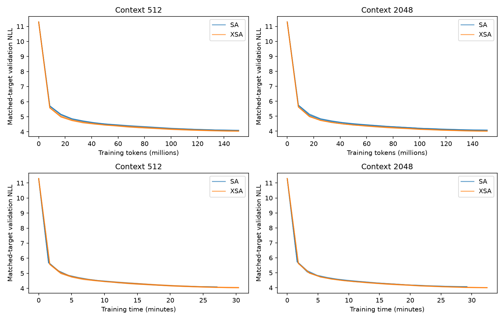

# Воспроизведение Exclusive Self Attention на FineWeb

**Статья:** Shuangfei Zhai, Apple. *Exclusive Self Attention*, arXiv:2603.09078v1, 2026. [PDF](https://arxiv.org/pdf/2603.09078v1).

## 1. Цель работы

Реализовать Exclusive Self Attention (XSA), проверить его влияние на качество языкового моделирования и измерить вычислительные расходы. Дополнительно проверить, увеличивается ли преимущество XSA с длиной контекста.

Работа представляет собой частичное воспроизведение: используются FineWeb-100BT и токенизатор GPT-2, однако модель и бюджет обучения существенно меньше исходных. Эксперимент включает три коротких запуска для выбора learning rate и 12 основных обучений.

## 2. Метод

Стандартный causal self-attention вычисляет взвешенную сумму value:

$$
y_i = \sum_{j \le i} a_{ij}v_j,
\qquad
a_{ij} = \operatorname{softmax}_{j \le i}
\left(\frac{q_i^{\top}k_j}{\sqrt{d_h}}\right).
$$

XSA удаляет составляющую результата, параллельную value текущей позиции:

$$
\hat{v}_i = \frac{v_i}{\lVert v_i \rVert},
\qquad
z_i = y_i - \left(y_i^{\top}\hat{v}_i\right)\hat{v}_i.
$$

Проекция применяется отдельно внутри каждой головы, до объединения голов и выходного линейного слоя. При точной арифметике и ненулевом value выполняется $z_i^{\top}v_i = 0$. Используется нормализация с epsilon для нулевых value. Параметры модели не добавляются.

Это не эквивалентно маскированию диагонали attention: удаляется также составляющая контекстных value, параллельная собственному value; веса softmax не перенормируются. Residual connection сохраняет путь передачи информации текущей позиции.

Основной вариант использует проекцию в dtype выхода attention под BF16 autocast. Отдельный benchmark сравнивает его с FP32-проекцией. Ортогональность в конечной точности проверяется численно, а не предполагается идеальной.

## 3. Данные и предотвращение пересечений

Использовано подмножество [HuggingFaceFW/fineweb](https://huggingface.co/datasets/HuggingFaceFW/fineweb), конфигурация `sample-100BT`, ревизия `9bb295ddab0e05d785b879661af7260fed5140fc`. Streaming-перестановка: seed=20261010, buffer=10000. В подготовленный набор вошли документы из 55 Common Crawl dumps; выборка разнообразнее одного литературного корпуса, но не является гарантированно равномерной выборкой всех 100B токенов.

Документ назначается в split по SHA256 полного текста: примерно 98% train, 1% validation, 1% test. Точные дубликаты исключаются. Поэтому одинаковый документ не может попасть одновременно в обучение и оценку. Near-duplicates отдельно не фильтровались.

| Split | GPT-2 tokens | Документов |
|---|---:|---:|
| Train | 220 001 064 | 316 632 |
| Validation | 2 000 008 | 2 671 |
| Test | 2 000 677 | 3 032 |

Токенизация выполнена с помощью `tiktoken gpt2`, размер словаря — 50 257 токенов. После каждого документа добавлен EOT-токен. Документы внутри split конкатенируются, поэтому attention может пересекать границу EOT. До обучения проверены целостность файлов, корректность границ документов и отсутствие точных повторов между split.

## 4. Архитектура и протокол

| Параметр | Значение |
|---|---|
| Transformer blocks | 8, pre-LN |
| Ширина residual stream | 512 |
| Attention heads | 4 × 128 |
| FFN | 2048, GELU |
| Position encoding | RoPE на Q/K |
| Дополнительная нормализация | LayerNorm после token embeddings |
| Выход LM | Общие веса с token embedding |
| Параметры | 50 936 320 всего; 25 204 736 без embedding |
| Dropout | 0 |
| Optimizer | AdamW fused; betas=(0.9, 0.95), eps=1e-8 |
| Weight decay | 0.1 для матриц; 0 для векторов |
| Gradient clipping | Global norm=1.0 |
| Global batch | 16 384 токена |
| Microbatch / accumulation | 4096 токенов / 4 |
| Основное обучение | 9216 шагов, 150 994 944 токена на модель |
| Seeds | 17, 42, 123 |
| Контексты | 512 и 2048 |
| Точность | FP32 weights/optimizer, BF16 autocast |
| Schedule | Warmup около 1% шагов; cosine decay до 0.1 max LR |

Всего обучены 12 моделей: два attention-механизма × три seed × две длины. Внутри каждого seed начальные веса SA/XSA совпадают. Для всех вариантов генерируются одинаковые окна длины 2048; короткий контекст получается разбиением окна на четыре части. Таким образом, совпадают целевые токены и их порядок, а различается доступная история. Sampling выполняется с возвращением: бюджет предъявлений не равен количеству уникальных токенов.

Порядок методов и контекстов чередуется между seed. Итоговое состояние модели не выбирается по test set.

### Выбор learning rate

Baseline SA с context=2048 и отдельным seed=3407 обучался по 25 165 824 токена для каждого LR. Выбор сделан только по validation:

| LR | Validation loss |
|---:|---:|
| 0.0003 | 5.572742 |
| 0.0006 | 5.282040 |
| **0.001** | **5.258113** |

Выбран LR=0.001 для всех основных запусков. Это лучший из трех проверенных вариантов на коротком этапе, а не доказанно оптимальный LR. Лучшее значение находится на верхней границе сетки, что остается ограничением.

### Оценка

Validation содержит 128 непересекающихся окон длины 2048, test — 512. В каждом оцениваются последние 256 target tokens. Для context=512 используется соответствующий суффикс того же окна. Следовательно, сравнение длин выполняется на одинаковых ответах: 32768 validation и 131072 test target tokens.

Метрика — cross-entropy в натуральных логарифмах на токен GPT-2; perplexity = exp(loss). Использованный протокол оценки суффиксов отличается от усреднения по всем позициям, поэтому абсолютный loss нельзя непосредственно сравнивать с графиками статьи. Окна могут относиться к одним документам и не считаются независимыми статистическими повторностями.

## 5. Результаты качества

### Средние по трем seed

Знак ± обозначает выборочное стандартное отклонение test loss между seed. Perplexity в таблице вычислена как экспонента среднего loss.

| Context | SA test loss | XSA test loss | SA PPL | XSA PPL | Снижение PPL |
|---|---:|---:|---:|---:|---:|
| 512 | 4.198272 ± 0.003895 | **4.152317 ± 0.011008** | 66.571 | **63.581** | **4.49%** |
| 2048 | 4.165250 ± 0.005332 | **4.109561 ± 0.004156** | 64.409 | **60.920** | **5.42%** |

### Парные результаты

Выигрыш определяется как loss(SA)−loss(XSA); положительное значение означает преимущество XSA.

| Context | Seed | SA test loss | XSA test loss | Выигрыш XSA |
|---:|---:|---:|---:|---:|
| 512 | 17 | 4.196168 | 4.143572 | +0.052596 |
| 512 | 42 | 4.195880 | 4.148701 | +0.047179 |
| 512 | 123 | 4.202767 | 4.164678 | +0.038089 |
| 2048 | 17 | 4.171347 | 4.108635 | +0.062713 |
| 2048 | 42 | 4.162941 | 4.105946 | +0.056995 |
| 2048 | 123 | 4.161462 | 4.114101 | +0.047362 |

XSA лучше во всех шести парах. Средний выигрыш составляет 0.045954 nats/token при context=512 и 0.055689 при context=2048. Приблизительные парные t-интервалы 95%: [0.027744; 0.064165] и [0.036416; 0.074962]. Они не пересекают ноль, но опираются на предположение нормальности разностей; при трех seed его нельзя надежно проверить.

На отдельных test windows XSA лучше в 387–436 из 512 случаев для короткого контекста и в 414–451 для длинного. Это показывает, что средний эффект не определяется только несколькими окнами, но не превращает окна в независимые повторные эксперименты.

## 6. Влияние контекста

| Seed | Выигрыш при 512 | Выигрыш при 2048 | Увеличение выигрыша |
|---:|---:|---:|---:|
| 17 | 0.052596 | 0.062713 | +0.010117 |
| 42 | 0.047179 | 0.056995 | +0.009815 |
| 123 | 0.038089 | 0.047362 | +0.009273 |

При увеличении контекста преимущество XSA растет у каждого seed. Среднее увеличение — 0.009735 nats/token, или около 21% относительно выигрыша на коротком контексте. Это поддерживает наблюдение автора для исследованных длин, но двух точек недостаточно для общей закономерности масштабирования.

## 7. Динамика обучения и время

| Context | Среднее время SA | Среднее время XSA | Дополнительное время |
|---:|---:|---:|---:|
| 512 | 27.10 мин | 30.37 мин | 12.1% |
| 2048 | 29.20 мин | 32.49 мин | 11.3% |

Время включает подготовку batch, передачу данных на GPU, forward/backward pass, шаг оптимизатора и синхронизацию. Validation и сохранение checkpoint в измерение не входят.

При шаге 8192 XSA уже имеет меньший validation loss, чем финальный SA на шаге 9216, во всех шести парах. При этом затраченное время обучения XSA немного меньше полного времени обучения SA. Следовательно, наблюдаемый выигрыш нельзя объяснить только дополнительными вычислениями. Отдельная оценка test loss при одинаковом временном лимите не выполнялась.

К концу обучения validation loss продолжает снижаться. Ранний разрыв между моделями был больше конечного, поэтому сохранение той же величины преимущества при существенно большем бюджете не установлено.

## 8. Стоимость attention-блока

Измерен полный блок attention+FFN на RTX 3090, batch=4, BF16, eager PyTorch. RoPE кэшируется; backend SDPA выбирается автоматически. После 10 warmup iterations выполняются пять раундов по 20 итераций; порядок методов чередуется. Ниже медианы средних wall times раундов с CUDA synchronization. Память — прирост пика allocated memory относительно уровня перед созданием блока; optimizer не включен.

| Width | Context | Режим | SA, мс | XSA, мс | Overhead |
|---:|---:|---|---:|---:|---:|
| 512 | 512 | forward | 0.489 | 0.535 | 9.5% |
| 512 | 512 | forward+backward | 1.325 | 1.518 | 14.6% |
| 512 | 2048 | forward | 1.639 | 1.792 | 9.3% |
| 512 | 2048 | forward+backward | 5.447 | 6.123 | 12.4% |
| 512 | 8192 | forward | 9.296 | 9.879 | 6.3% |
| 512 | 8192 | forward+backward | 30.076 | 32.609 | 8.4% |
| 1536 | 512 | forward | 2.225 | 2.353 | 5.7% |
| 1536 | 512 | forward+backward | 6.932 | 7.457 | 7.6% |
| 1536 | 2048 | forward | 8.825 | 9.287 | 5.2% |
| 1536 | 2048 | forward+backward | 28.119 | 30.052 | 6.9% |
| 1536 | 8192 | forward | 44.729 | 46.457 | 3.9% |
| 1536 | 8192 | forward+backward | 146.555 | 153.978 | 5.1% |

Относительная стоимость XSA уменьшается с ростом исследованных форм тензоров. Для самого большого блока forward+backward память возрастает с 2939.28 до 3036.40 MiB, примерно на 3.3%. Совпадение измеренного пика памяти forward у некоторых вариантов не означает отсутствия дополнительных выделений: они могут не превысить общий пик блока.

В численной абляции FP32-проекция для width=1536/context=8192 дает 161.357 мс вместо 153.978 мс у основного XSA. Следовательно, точность арифметики влияет на вычислительные расходы. Наблюдаемые накладные расходы умеренные, но не нулевые.

## 9. Диагностика механизма

Исследован заранее выбранный seed=17, context=2048, 32 validation windows. Из cosine выхода исключена первая позиция, где causal XSA дает нулевой результат в точной арифметике. Для абсолютного cosine дополнительно исключаются выходы с нормой ≤1e-6.

| Layer | SA mean cos(Y,V) | XSA mean cos(Y,V), до | XSA mean abs cos(Z,V), после |
|---:|---:|---:|---:|
| 1 | 0.28729 | 0.47915 | 0.00021 |
| 2 | 0.12329 | 0.83733 | 0.00944 |
| 3 | 0.27143 | 0.90365 | 0.00032 |
| 4 | 0.18638 | 0.84905 | 0.00025 |
| 5 | 0.28172 | 0.75450 | 0.00032 |
| 6 | 0.17818 | 0.81707 | 0.00025 |
| 7 | 0.33478 | 0.68032 | 0.00028 |
| 8 | 0.46019 | 0.73875 | 0.00021 |

Проекция резко подавляет совпадение направлений. У XSA возрастает средний вес диагонали attention: во втором и третьем слоях около 0.513 и 0.588. Это согласуется с интерпретацией диагонали как места для attention mass, чей прямой self-value вклад удаляется. Однако корреляционные измерения не доказывают причинную роль этого поведения в улучшении качества.

Во втором слое встречаются редкие отклонения: максимальный абсолютный cosine после XSA достигает 0.997, хотя среднее значение p95 по окнам равно 0.000957. Вероятная причина — чувствительность cosine при почти нулевой норме остатка и округлении BF16. Поэтому строгая ортогональность гарантируется в точной арифметике, тогда как при BF16 она выполняется с численной погрешностью.

## 10. Проверки и воспроизводимость

Автоматические тесты проверяют одинаковую инициализацию пар SA/XSA, совпадение target tokens между контекстами, выбор позиций для evaluation, свойства проекции и вычисление loss на заданном суффиксе. Перед основной серией также выполнен короткий сквозной запуск.

Для всех 12 запусков проверены одинаковый learning rate, версия данных и запланированное число шагов и токенов. Ошибок исполнения и нечисловых значений в логах не обнаружено.

Среда: NVIDIA RTX 3090 24 GiB, Python 3.11.15, PyTorch 2.13.0+cu130, CUDA runtime 13.0. Seeds фиксированы, но строгие deterministic algorithms не включены. На другом оборудовании или версии библиотек побитовое совпадение не гарантируется.

Ключевой код, зависимости и команды запуска приведены в [code/README.md](code/README.md).

## 11. Ограничения и сопоставление со статьей

В воспроизведенной модели около 25 млн параметров без embeddings против примерно 700 млн у минимальной модели статьи. Бюджет одного запуска — 151 млн токенов против примерно 100 млрд в статье. Поэтому эксперимент проверяет перенос эффекта на уменьшенный масштаб, а не численно повторяет исходные графики и таблицы.

## 12. Вывод

На подмножестве FineWeb-100BT XSA улучшил test loss относительно стандартного attention во всех шести парных сравнениях. Perplexity снизилась примерно на 4.5% при контексте 512 и на 5.4% при контексте 2048. Увеличение контекста усилило преимущество у всех трех seed. Дополнительное время обучения составило около 11–12%; преимущество на validation наблюдается и при сопоставимом обучающем времени.

Результаты поддерживают основные эмпирические идеи статьи в исследованном уменьшенном масштабе. Они не доказывают универсальное превосходство XSA или сохранение эффекта после масштабного обучения. Диагностика показывает сильное подавление self-value alignment, одновременно выявляя ограничение численной ортогональности BF16.

## Источники

1. [Zhai, Exclusive Self Attention, arXiv:2603.09078v1](https://arxiv.org/pdf/2603.09078v1).
2. [Официальная страница Apple](https://machinelearning.apple.com/research/exclusive-self-attention).
3. [FineWeb — HuggingFaceFW](https://huggingface.co/datasets/HuggingFaceFW/fineweb).
4. [nanoGPT](https://github.com/karpathy/nanoGPT) — codebase, указанный в статье; компактная реализация в этой работе самостоятельная.
